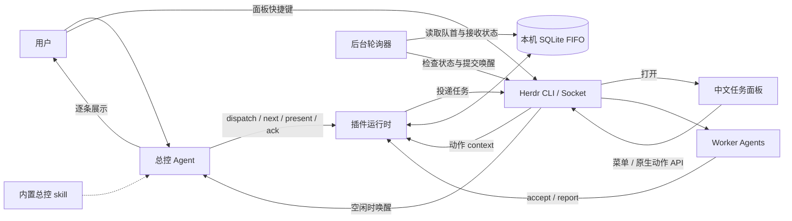
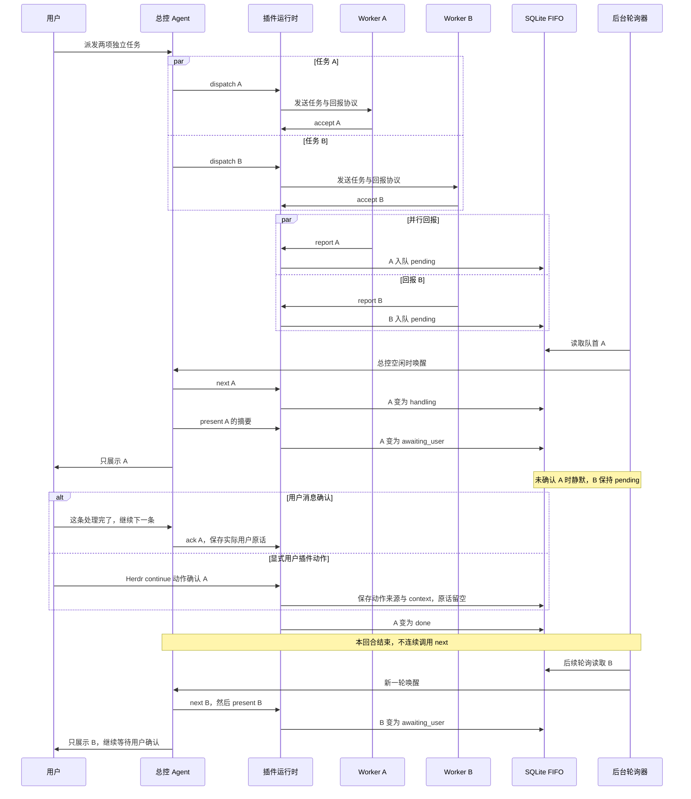

# Herdr Orchestrator

用于 Herdr 的任务编排插件：worker 并行执行，总控逐条展示回报。
多个结果同时到达时，只通知当前一条；用户明确处理完或主动归档后，再主动通知下一条。

## 从一个面板入口开始

已安装推荐键后，先按 Ctrl+B，松开，再按 Shift+O（大写 O），打开 **总控任务面板**。
也可从 Herdr 动作菜单选择同名动作，或执行：

```sh
herdr plugin action invoke status --plugin herdr-orchestrator
```

在空闲 Agent 窗格打开面板，按 m 进入操作菜单，选择“启动 / 恢复”。首次绑定这个 Agent；
已有绑定只恢复原总控。向总控发任务后，面板显示执行 Agent、中文状态和当前等待的结果。
Enter 查看持久回报全文，↑↓ 或 j/k 滚动，q / Esc 返回；主列表每两秒只读刷新并保留所选任务，同时更新打开面板那个窗格的候选 Agent；按 r 也刷新其当前身份。
查看、刷新、打开和退出都不确认结果。

支持鼠标的终端中，也可以**单击任务选中、双击任务看全文、滚轮滚动**。
首页直接点击 **「回到总控」** 或按 **f**，成功后关闭面板并定位到绑定总控，无需进入菜单。
无需打开面板辨认总控：Herdr 展开的 **Agents** 侧栏会显示 **「总控 · 代理名」**（未命名时显示 Agent 类型）。
启动/恢复自动同步，切换时移除旧标记；暂停显示「总控（已暂停）」并保留绑定。
总控开启新对话后，先发送一条普通消息，让 Herdr 更新原生会话身份；在该窗格打开面板，按 r 刷新，再用菜单 3 重新指定。
定位只是回到绑定的窗格，换会话后也能使用；定位本身不授予新会话总控身份。
标记通过独立的显示元数据提供，不改代理名、空间名、原生会话身份或运行状态；不是权限判断依据。
底部带方括号的按钮和操作菜单可以单击；所选任务整行高亮，详情、菜单和预览各有独立标题。
窄窗口中的按钮自动换行，缩放后重新计算点击位置。键盘操作仍全部保留。

| 鼠标操作 | 结果 |
| --- | --- |
| 单击任务标题或状态行 | 选中同一任务，不确认结果 |
| 双击任务 | 打开全文详情 |
| 单击底部按钮 | 回到总控、查看详情、操作菜单、历史、刷新或返回/退出 |
| 单击菜单项 | 启动/定位/暂停直接提交；更换/处理完成/归档先打开目标预览 |
| 单击预览中的确认按钮 | 执行固定目标的操作；取消按钮只返回 |
| 滚轮 | 主列表移动选择，其他页面滚动正文 |

按钮采用单击操作；拖动、空白区域和普通双击不会代替确认按钮。终端不支持鼠标或 SSH 客户端未透传事件时使用键盘。

主列表默认只显示**待处理任务**，已处理或已撤销的历史任务自动隐藏，让列表保持简洁。
在主列表按 **h** 查看全部历史，再按 h 回到待处理列表；每次重新打开默认使用简洁视图。
历史中的任务详情和回报全文仍可用 Enter 查看。隐藏仅影响显示，不删除记录、不取消任务，也不确认结果。
worker 已回报完成但结果仍排队、等待用户处理或等待后续接收时继续显示；尚未结束的阻塞任务也会保留。

不想继续处理的任务可以直接归档：在当前 Herdr 会话的任意窗格打开面板，↑↓ 选中任务，按 m，再选择 **6「归档所选任务」**。
核对预览中的任务目标和执行 Agent，按 y 或单击确认归档按钮。它立即退出待处理列表和回报提醒队列；按 h 仍能查看历史全文。
归档由插件脚本直接写入 SQLite，无需总控模型执行、回复或处于空闲状态；执行成功后显示“任务已归档”。
运行中的 Agent 不会被关闭，归档后的接收和回报仍保存，但不再主动提醒。
若归档当前结果后仍有其他待处理回报，后台会另行提醒总控处理下一条；这条通知不是执行归档的指令。
归档不表示业务完成，不生成用户完成确认，也不会撤回已经发送的提醒或终止已经执行的操作。
一次只归档选中的任务派发；同一目标的其他派发、后续任务和未选中的任务保留。重复归档保持原时间，不归档下一条。

| 菜单 | 触发位置与前提 | 结果 |
| --- | --- | --- |
| 1 启动 / 恢复 | 首次需打开面板的 Agent 有原生身份；已有绑定使用原总控 | 启动自动提醒，等待总控准备就绪 |
| 2 定位总控 | 已有绑定且身份有效 | 定位后关闭面板，在总控窗格重新打开 |
| 3 更换 / 重新指定总控 | 候选是打开面板时的 Agent；新旧总控均须空闲 | 先预览明确目标，按 y 切换，保留任务与等待状态 |
| 4 暂停自动提醒 | 已有绑定 | 等待后台轮询退出；正在工作的 Agent 继续，结果仍可回报 |
| 5 当前结果已处理完 | 从空闲总控窗格打开，结果已展示并等待你处理 | 预览本条正文，按 y 记录确认，接收齐全后才通知下一条 |
| 6 归档所选任务 | 当前会话的任意窗格打开，列表中选定任务 | 预览目标，按 y 持久归档；历史保留，停止该任务的回报提醒 |

启动、定位、暂停响应明确的数字菜单选择或单击菜单项。更换、处理结果和归档需预览后按 y 或单击确认按钮；Enter 只看详情，不执行菜单或确认。
菜单 5 针对首页“当前等待结果”，不是任意选中的任务。菜单、详情和预览页固定显示对象；r 返回主列表刷新。后台换成下一条时，旧预览只能关联原条或被拒绝。
不会自动定位后确认，也不把其他窗格伪装成总控。程序不能证明真人输入，模型不得自动替用户选“处理完”。

以下为通用示意，运行时显示当前会话任务：

```text
总控任务面板
总控：协调 Agent
状态：自动提醒已开启
当前结果：核对文档示例
等待你处理；查看不会确认
── 待处理任务（2 项，历史 3 项） ──
> 核对文档示例
  等待用户处理 | 文档 Agent | 10-12 09:30
  检查本地测试
  回报排队中 | 测试 Agent | 10-12 09:31
[ 回到总控 f ] [ 详情 Enter ] [ 操作 m ]
[ 历史 h ] [ 刷新 r ] [ 退出 q ]
单击选择 · 双击全文 · 滚轮滚动
```

窄窗会截短列表行，详情保留完整正文；调整大小后重绘。面板不依赖颜色，中文按终端单元宽度排版。
非 TTY 的 CLI board 只输出一次静态可读视图，不调用动作；交互操作需从真实 Herdr 插件面板发起。

## 能力

- 内置总控 skill、派发协议、持久 FIFO、后台轮询和统一中文任务面板。
- Herdr Agents 侧栏自动标记总控，暂停与切换同步；显示元数据和实际身份校验分离。
- worker 明确接收后执行任务，完成或阻塞时回报实际结果与证据。
- 摘要、用户原话和确认时点持久保存，暂停和重启不解除等待用户状态。
- 同条后续派发接收齐全后可出队，不等待后续任务执行完成。
- 不同 Herdr 会话各自绑定总控并隔离队列，校验原生代理会话身份。

<details>
<summary>高级协议：组件架构</summary>



总控负责理解任务、选择 worker、派发与汇总；worker 负责授权范围内的业务操作。
Mermaid 代码块按 [GitHub 官方图示指南](https://docs.github.com/en/get-started/writing-on-github/working-with-advanced-formatting/creating-diagrams)编写。

</details>

## 环境要求

| 项目 | 要求 |
| --- | --- |
| Herdr | 客户端与运行服务均为 0.9.3+，支持原生 `agent_session` |
| Python | 3.11+，含标准库 curses；无需 pip 依赖 |
| Git | 可访问使用者选择的 GitHub 仓库与 ref |
| 系统 | Linux 或 macOS |
| Agent | 运行在 Herdr 管理的窗格内，已加载对应 integration |

尚未安装 Herdr 时，先按 [Herdr 官方 README](https://github.com/herdrdev/herdr/blob/master/README.md)准备环境。
下文的 `<owner>` 从当前插件仓库地址填写，其他尖括号内容也需替换；不要原样执行占位符。

## 快速开始

### 1. 安装插件

在目标 Herdr 会话内检查环境，核对输出；检查失败时先处理缺项，再安装固定版本：

```sh
test "${HERDR_ENV:-}" = 1
herdr --version
herdr status server
python3 --version
git --version
herdr plugin install <owner>/herdr-orchestrator-plugin --ref v0.6.3
herdr plugin list --plugin herdr-orchestrator --json
```

核对运行服务的版本与客户端兼容，JSON 中的版本为 0.6.3、`enabled` 为 true，来源与 ref 符合预期。
交互安装会展示信任预览；已授权的非交互安装可加 `--yes`。命令依据 [官方 CLI 文档](https://github.com/herdrdev/herdr/blob/master/docs/next/website/src/content/docs/cli-reference.mdx)。

Codex 用户先检查 integration，仅在缺失或过期时安装：

```sh
herdr integration status
# 仅在 codex integration 缺失或过期时执行
herdr integration install codex
```

已有 Codex 进程不会因为安装 integration 自动加载新设置。按需新启动 `codex --no-daemon`，
沿用用户已有审批和沙箱配置；发送第一条普通消息后，用 `herdr agent get <目标>` 核对 `agent_session.value`。
插件无需 pip 依赖，也无需将 bundled skill 复制进全局技能目录。

### 2. 绑定总控

用 `herdr agent list` 选择已运行的代理。手动方式：在 UI 选择该代理窗格，
打开 **总控任务面板**，按 m，再选择 1“启动 / 恢复”。
`start` 首次根据动作 context 的 focused pane 绑定；已有绑定时恢复原总控，不因焦点在别处而切换。

插件在总控空闲时发送准备提示，完成后面板显示就绪状态；动作启动不等于总控已经准备好。
需要保持用户焦点的自动安装，使用后文 Agent 安装提示中的显式绑定方式。

### 安装推荐面板键

默认推荐 `prefix+shift+o`，完整动作名 `herdr-orchestrator.status`。
安装器只追加这个面板键；以前安装的六个键保留可用，列在文末高级操作中。

推荐键不会自动安装。用户明确安装时执行：

```sh
herdr plugin action invoke install-shortcuts --plugin herdr-orchestrator
herdr plugin log list --plugin herdr-orchestrator
```

action invoke 返回异步启动回执，不能据此认为安装已完成。先核对该次动作日志已结束，退出码为 0，
且输出包含 `installed` 或 `already_installed` 结果；失败时按具体诊断处理。完成后再执行：

```sh
herdr config check
herdr server reload-config
```

安装器按 `HERDR_CONFIG_PATH` 或当前 Herdr 配置目录规则定位文件，只追加缺少的 `keys.command`，
全部使用 `type = "plugin_action"` 和完整动作名，不改 prefix；Herdr 默认 prefix 是 Ctrl+B。
按键是两段操作：先按 Ctrl+B，松开后再按表中的键；例如 prefix+shift+o 的第二段是 Shift+O（大写 O）。
候选配置先经真实 `herdr config check`，既有键或原生动作冲突会整次拒绝，不部分写入。
原文件文字、注释、权限和其他快捷键保留；首次修改保留一份权限 0600 的 `.herdr-orchestrator.bak`，重复安装幂等。
安装后重载配置；当前已打开的客户端若还没有识别新键位，执行 UI 的 `reload config`（默认 Ctrl+B 松开后按 Shift+R），
它会同时刷新客户端本地设置和所选服务端配置；也可 detach 后重新连接现有会话，无需关闭 Agent。
服务端 CLI 重载与客户端本地重载的区别见 [官方重载说明](https://herdr.dev/docs/configuration/#reload-config)。
远程客户端默认使用客户端本地键，可按官方选项选择服务端键。SSH 登录后直接运行 Herdr 时，配置属于该运行主机。

switch 先校验新总控身份与空闲状态，旧总控忙时拒绝；旧窗格已关闭可恢复到新总控，其他传输错误直接上报。
切换先暂停并有界等待旧轮询释放锁，再重新绑定、启动和激活；不关闭 Agent，不丢弃任务、确认或等待状态。
同目标重试保留激活状态。等待退出超时会明确报错并保持暂停；等待期间新目标变忙或身份改变也不会绑定。
focus 仅定位，不读取或确认队列，不因同窗格换了原生会话而阻止定位；重新授权仍需显式 switch。总控标记只改变 Agents 的显示标签；若自定义侧栏隐藏了 `agent` token，需在 Agents 布局中保留它才能看到。
Spaces 不自动改名或调整个人侧栏布局。参见 [Herdr 显示元数据](https://herdr.dev/docs/cli-reference/#panes)。

### 3. 发任务并逐条处理

直接向总控发送自然语言，无需手工管理内部 ID。例如：

```text
请把以下两项任务分别交给 worker：
在 /tmp/herdr-orchestrator-demo/hello.txt 写入 hello，在同目录 world.txt 写入 world。
只允许创建和读取该临时目录里的文件，分别回报实际内容。
优先复用合适的空闲 worker；每次只展示一条，等我处理完并确认，再主动通知下一条。
```

<details>
<summary>高级协议：逐条通知时序</summary>

下面假设任务 A 先入队；实际顺序以 SQLite 成功写入的先后为准，本例没有后续派发。



</details>

说「这条处理完了」或「继续下一条」确认当前条。普通新任务、无关消息、仅追问或补充信息不自动确认。
也可在已绑定且空闲的总控窗格打开面板，选择 5 并按 y；含义是当前条已经处理完，必须已 present 等待用户。
空队列、未展示、错焦点或总控忙时拒绝；重复动作不越过当前条，已确认等待 accept 时不要求二次确认。
continue 不直接 next，不循环清队列；下一条仍由轮询在另一个回合唤醒。模型不得自动调用它代替用户。
同任务补充通常保留原 task ID 并交原 worker；用户指定其他代理或需要专用 worker 时按实际分工处理。
若同一消息明确确认当前条并安排后续，总控先登记后续派发，再保存确认；全部 accept 后才出队。
确认先于 accept 时，原话和时点先保存，不要求用户重复回复；已确认的接收异常只提醒检查当前条。

worker 的回报按任务复杂度说明结论、实际做了什么、重要具体结果或数据、关键依据与结果文件、
验证方式及重要输出和验证层级、未解决项或限制及下一步。完成回报不能只有「成功/已完成」或一个路径；
简单问候保留完整回复原文即可，无需凑字段或固定模板，也不需要推理过程或全部工具日志。
总控完整读取回报正文，保留判断和后续处理所需的具体内容，区分 worker 自报与总控实际核验；摘要不等于核验。
长报告先展示充分信息，再提供全文入口；present 保存这份展示正文，`summary-file` 的名称不要求压成简短摘要。

### 4. 查看状态、暂停与恢复

```sh
herdr plugin action invoke status --plugin herdr-orchestrator
herdr plugin action invoke stop --plugin herdr-orchestrator
herdr plugin log list --plugin herdr-orchestrator
```

统一面板显示绑定、任务目标、Agent、中文状态和错误；详情可读完整持久回报，关闭窗口只关闭视图。
stop 保留 worker 与历史，已派发 worker 仍可回报；恢复时执行 start，它使用已有绑定。
代理身份变化或用户要更换总控时，选中新目标并执行 switch；高级 CLI 仍可暂停后显式 rebind。
插件安装和 enabled 状态在同一用户的各 Herdr 会话间共享。

## 交给 Agent 安装

将下面提示复制给运行在 Herdr 内的 Agent，并填写仓库、版本和总控目标。
安装前由使用者决定是否信任插件；提示中的安装、绑定和 integration 修复属于本次请求授权。

```text
请安装并配置 Herdr Orchestrator：
仓库：<owner>/herdr-orchestrator-plugin（从当前仓库地址填写）
版本：v0.6.3
总控：<用户指定的现有代理名或窗格 ID>

1. 确认 HERDR_ENV=1；检查 Herdr 客户端、当前运行服务的版本和兼容性、Python 3.11+、Git。
   检查 integration status；缺失或过期时修复对应 integration，勿声称已有 Agent 自动加载。
   核对目标代理已发送第一条普通消息且有 agent_session.value，缺失就报告具体问题，不猜身份。
2. 若已安装，先列出受影响的启用会话并暂停其编排，等待旧轮询进程退出，做 SQLite 一致备份。
   GitHub 安装版按新 ref 重新 install，无需先 uninstall；本地 link 先按官方流程处理，不删除源码或状态。
3. 执行 herdr plugin install <owner>/herdr-orchestrator-plugin --ref v0.6.3 --yes。
   再读 herdr plugin list --plugin herdr-orchestrator --json，核对来源、ref、version、enabled，获取 plugin_root。
4. 确定实际 state-dir 与当前服务 socket：优先使用实际插件上下文的 HERDR_PLUGIN_STATE_DIR。
   若按官方对应版本的目录规则定位，必须核对运行服务的 HOME/XDG_STATE_HOME 和 release/debug 类型。
   config-dir 不等于 state-dir；不套用示例路径、不输出整个环境或凭据。无法确认就报告缺项，不猜路径。
5. 以实际 Python、plugin_root/orchestrator.py、--state-dir 和 --socket 组成完整 CLI，先读 --help。
   不改变用户焦点，用 CLI bind --target <用户指定目标>；身份冲突时先暂停，再按明确指定目标 rebind。
6. 总控读取 plugin_root/skills/herdr-orchestrator/SKILL.md，并由该总控执行 CLI ready。
   安装者不冒充总控执行 ready，不复制 skill 到全局目录；新 Codex 仅默认 --no-daemon，权限沿用用户授权。
7. 回读 CLI status 确认目标、enabled、activated、轮询与错误，核对插件日志，报告实际完成和缺项。
   不伪造用户 ack；业务闭环测试只在另获授权的临时范围内运行，并标明测试输入与真实用户确认的区别。
8. 只有用户明确要求安装推荐快捷键，才调用 install-shortcuts 动作；异步启动回执不代表完成。
   核对动作日志已结束、退出码 0 和 installed/already_installed 输出，再 config check 和 reload-config。
   检查备份结果；prefix 为两段操作，先按原 prefix 并松开，再按第二段键，推荐键为 Ctrl+B 松开后 Shift+O（大写 O）。
   已打开客户端必要时 Ctrl+B 松开后 Shift+R 重载，或 detach 后重连，不关闭 Agent。
   只追加面板键，保留旧六键，不覆盖已占用键或改变 prefix；start 仅恢复，切换由用户显式选择。
```

插件运行上下文与目录用途见 [官方插件文档](https://github.com/herdrdev/herdr/blob/master/docs/next/website/src/content/docs/plugins.mdx)。
路径定位核对对应版本的 [插件目录实现](https://github.com/herdrdev/herdr/blob/master/src/plugin_paths.rs)和 [状态目录实现](https://github.com/herdrdev/herdr/blob/master/src/config/io.rs)。

## 升级与数据

先在各启用会话暂停编排并确认旧轮询进程退出；暂停不会停止 worker 写回报。
使用 SQLite backup 生成一致备份；直接复制时需停止数据库写入并连同 WAL 保存，不能只复制活动数据库文件。
然后按新 ref 重新安装 GitHub 版，**无需先卸载**：

```sh
herdr plugin install <owner>/herdr-orchestrator-plugin --ref v0.6.3 --yes
herdr plugin list --plugin herdr-orchestrator --json
```

按官方重装流程更新 GitHub 安装版并保留配置和状态；重装不会自动重启插件运行进程。
从 plugin list 重新取得实际 plugin_root，核对原状态目录与版本；确认旧轮询已停，再用新版入口恢复各会话绑定。
v0.4 和更早版本的入口不能打开 schema v4。已有 worker 的任务和执行过程保留；在它空闲时提供新版 CLI 回报入口，
沿用原 state-dir、socket、派发 ID、message ID 和结果文件，不重新派发或重做业务。旧命令报版本错误时也是如此处理。
旧状态弹窗不会随安装自动替换运行中的进程：先关闭旧弹窗，再重新打开。
新版用 q 退出；旧版 q 不响应时，确认当前处于该状态弹窗内，再按 Ctrl+C，只退出视图。
不要在 Agent 窗格盲按 Ctrl+C。回到主界面后 Ctrl+B 松开再 Shift+R 刷新，再 Ctrl+B 松开再 Shift+O 打开新面板。
参见 [官方 CLI 的重装规则](https://github.com/herdrdev/herdr/blob/master/docs/next/website/src/content/docs/cli-reference.mdx)。

v0.5 和 v0.6 均使用 schema v4；v0.6.x 不新增数据库迁移；v0.6.1 增加首页定位与独立面板归档，v0.6.2 增加 Herdr Agents 总控显示标记；v0.6.3 修复换对话后的定位和候选身份刷新。从更早版本升级时，事务新增任务归档时间字段，已有任务默认未归档；原记录不自动清理。
从 v0.1.0 或 v0.2.x 升级时，先沿用 schema v1/v2 至 v3 的迁移，保留展示与消息确认字段，新增确认来源和动作 context，再迁移至 v4。
原任务、回报、摘要、序号和接收记录保留；pending/handling 不自动 done，旧 done 不伪造用户确认。
只有既有确认时点和非空原话同时存在，迁移才标为 message；缺证据的历史确认来源保留为空，不补造动作或消息。
v0.3 与 v0.4 使用 schema v3，相互兼容；它们不支持本次的 schema v4。回退到 v0.4 或更早版本须暂停后恢复升级前的一致备份，不手动降低数据库版本号。
未归档任务的等待用户状态在暂停和重开后保持；归档记录也不会因重启重新进入提醒队列。显式更换总控仍需激活 skill。

## 故障排查

总控提示身份变化时，表示 Herdr 当前上报的原生会话与插件保存的身份不一致，常见于开启新对话。不要将模型说“我是总控”视为已绑定：先发一条普通消息建立当前身份，再点击“回到总控”，在该窗格重开面板，按 r 并选择 3 重新指定；历史、回报和用户确认保留。旧预览仍拒绝新的身份，必须刷新后重新预览。

| 现象 | 检查和处理 |
| --- | --- |
| 版本或环境不满足 | 对照客户端、运行服务、Python 和 Git；缺 Herdr 环境时回到受管窗格。 |
| 缺少原生会话身份 | 检查 integration；按需新启动 Agent，第一条消息后核对 agent_session，不造 ID。 |
| 已启用但没激活 | 查绑定、activated、动作日志与轮询错误；总控 working/blocked/unknown 时不投递。 |
| 等待用户且下一条已到达 | 属于正常 FIFO；确认当前条后才会通知下一条，不重复催用户。 |
| 已确认但仍在等待接收 | 查后续派发 accept；blocked/missing/replaced 只提醒当前接收问题，不重发任务。 |
| 派发超时或投递不明 | 查已保存的派发及 worker 状态；超时不代表未执行，不盲目重派。 |
| 总控被替换 | 暂停后显式 bind --target 并加 --rebind，保留历史与等待状态。 |
| 本地 link 与 GitHub 安装冲突 | 先暂停，再 unlink 本地插件后安装；源码与数据不主动删除。 |
| Agent 调用插件被沙箱拒绝 | 总控和 worker 需有 Herdr socket 与插件状态目录访问权限；按用户已有授权配置处理。安装 integration 不会自动解除沙箱限制，不默认放宽权限。 |

卸载前暂停各会话并备份需要的数据。`plugin uninstall herdr-orchestrator` 不关闭 worker；数据生命周期由使用者管理。

## 协议与边界

- 运行数据持久化在本机，插件不将其写入 GitHub；Agent 与模型按各自配置处理上下文，不承诺上下文永远留在本机。不要把运行数据放进安装源码目录。
- FIFO 以 SQLite 入队顺序为准，只有当前队首可展示或首次确认。未确认的 awaiting_user 保持静默。
- 用户明确归档的任务单独退出提醒队列，保留原回报状态、正文和已有确认，不补造 done 或用户答复。归档后接收与回报仍保存到历史；归档不终止 Agent。
- ack 保存 message 来源、实际用户原文和文件位置；continue 保存 plugin_action 来源、确认时点和实际 context，原文和文件位置为空。
- action 校验插件 ID、动作 ID、Herdr context 和原生总控身份；不要求 HERDR_PLUGIN_EVENT=action。invocation_source 按实际 panel/keybinding/cli/api 等元数据记录，不声称能证明真人按键或消息真实性。
- Agents 标记通过插件独立 source 的 `pane.report_metadata` 显示字段提供。运行中每次轮询刷新，15 秒未刷新自动过期，避免旧轮询迟到写入或异常退出后长期残留；暂停标记保留到恢复、切换或原生 Agent 退出。清除只影响插件自身显示层，其他来源的标题与标签保留。它不接管 lifecycle，也不更改任务队列或 SQLite schema。
- 面板通过原生 plugin.action.invoke 提供合法 context，由 Herdr 注入动作身份；correlation_id 关联显示的 event/任务/目标身份，runtime 校验旧视图边界；请求关联不增加数据库字段，也不伪造 ACTION_ID。见 [官方插件 API](https://herdr.dev/docs/socket-api/#plugin-apis)。
- 同 event 同原文重试幂等，保留确认时点；冲突原文拒绝，旧确认不会确认新的队首。确认后封闭该条的后续派发。
- 未归档任务的结果处理要求持久用户确认与所有未撤销、未归档后续派发 accept；代理 idle/done、超时、accept 和归档均不是业务完成。归档后续派发不确认父结果。
- 每 5 秒是轮询周期，不是最终通知时延承诺；总控忙、被审批阻塞或宿主离线时通知推迟。未展示通知最多每分钟重试。
- 聊天展示与 present、终端派发与 SQLite 不能共享事务，不保证 exactly-once；极端中断需核对摘要、聊天与接收记录。
- 直接原生 agent prompt --wait 的终端答复不进入队列；所有需逐条回报的任务应走 dispatch/accept/report。
- 插件与 skill 不扩大权限，不代答未授权审批，也不是代理沙箱；暂停编排不会终止 worker。

## 开发与验证

```sh
python3 orchestrator.py check-runtime
python3 -m unittest discover -s tests -v
herdr plugin link "$PWD"
```

unittest 覆盖 SQLite、并发生产者、CLI 子进程、FIFO、确认/接收门槛、归档与迟到回报、v1/v2/v3 迁移、动作 context、切换锁、配置保留及冲突；Agent 传输使用 FakeHerdr 或模拟 CLI，配置测试在 Herdr 可用时调用真实 config check。
仓库记录的 Linux 集成验证使用 Herdr 0.9.3、Codex 0.162.1，一个真实总控和两个真实 worker：
两条回报经插件协议入队，先展示第一条，等待超过两分钟不展示第二条；确认后轮询另起一轮展示第二条。
该验证的模型与终端投递是真实的，处理完成消息是隔离测试输入，不能充当正式会话的实际用户确认。
隔离 Linux 验证会区分真实 Herdr 动作入口、程序输入的测试按键和实际用户确认；模拟 context 或按键不能当作真人操作证明。
中文面板验证区分本地行为测试、真实 Herdr popup 和程序输入的 PTY 按键；不是正式用户确认或真人证明。
未验证 macOS、真实审批 UI、整个服务重启后的模型恢复和正式用户亲自完成两条回报；不把默认沙箱下模型 socket 调用失败写成自主 ready/next/present 已通过。

<details>
<summary>高级 CLI 协议（供总控与 worker 使用）</summary>

`CLI` 是激活消息里的完整入口占位词，含 Python、绝对程序路径、state-dir 和 socket，不是新增系统命令。

```text
CLI ready
CLI dispatch --target WORKER --task-file TASK.json
CLI wait-accepted --dispatch DISPATCH_ID --timeout 10
CLI next
CLI present --event EVENT --summary-file /tmp/herdr-orchestrator-demo/summary.txt
CLI dispatch --target WORKER --task-file TASK.json --task-id TASK_ID --parent-event EVENT
CLI ack --event EVENT --reply-file /tmp/herdr-orchestrator-demo/user-reply.txt
CLI accept --dispatch DISPATCH_ID
CLI report --dispatch DISPATCH_ID --message-id MESSAGE_ID --status completed --result-file /tmp/herdr-orchestrator-demo/result.txt
CLI status
CLI stop
CLI bind --target COORDINATOR --rebind
CLI abandon --dispatch DISPATCH_ID --reason 已检查的撤销原因
CLI archive --dispatch DISPATCH_ID
```

任务 JSON 必须含非空字符串 goal、scope、authorization、acceptance_criteria。worker 的具体命令由派发消息提供，必须先 accept 再执行，结果状态为 completed 或 blocked。
结果、摘要与确认文件必须是绝对路径 UTF-8 文件，正文持久保存。next 只将 pending 改为 handling；present 保存摘要并进入 awaiting_user，相同摘要重试幂等。
只有最新实际用户消息明确确认当前条才 ack；显式用户 continue 动作单独记录来源，模型不得自动调用。普通追问不自动出队。
确认先于 accept 时保留原确认和来源，未撤销、未归档的后续派发接收齐全后自动出队，不要求重说。
确认后结束本回合，下一条由轮询唤醒，不批量 next。finish 已移除；abandon 撤销回报资格，不停止 worker。
archive 由绑定总控在用户明确指定任务后执行，校验会话，按派发 ID 幂等归档，不调用 next，也不修改原回报确认。
面板归档动作通过原生 API 关联固定所选任务，脚本校验当前会话与预览绑定后直接持久归档，不调用模型、不要求总控存活或空闲；没有选中任务时不能直接执行。模型不得自行选择待处理任务归档来缩短列表。

</details>

<details>
<summary>高级独立动作与旧快捷键</summary>

常用操作使用面板即可。下面六键在旧版显式安装后继续可用；新版安装器不删除、重写或重新安装它们。

| 完整动作名 | 旧推荐键 | 含义 |
| --- | --- | --- |
| herdr-orchestrator.status | prefix+i | 打开同一个中文面板 |
| herdr-orchestrator.start | prefix+a | 首次绑定，之后恢复原总控 |
| herdr-orchestrator.switch | prefix+shift+a | 更换为当前空闲 Agent |
| herdr-orchestrator.focus | prefix+shift+i | 只定位总控 |
| herdr-orchestrator.stop | prefix+shift+s | 只暂停自动提醒 |
| herdr-orchestrator.continue | prefix+enter | 当前已展示结果处理完，需总控空闲且焦点正确 |

完整动作名与 CLI 原有接口保留。推荐 prefix 不变，默认 Ctrl+B；Shift+A / I / S 分别是大写 A / I / S。
只有显式用户选择才确认；模型不应自动调用 continue 或面板处理完成菜单。

</details>

## 许可证

[MIT License](LICENSE)，Copyright (c) 2026 Herdr Orchestrator contributors。
