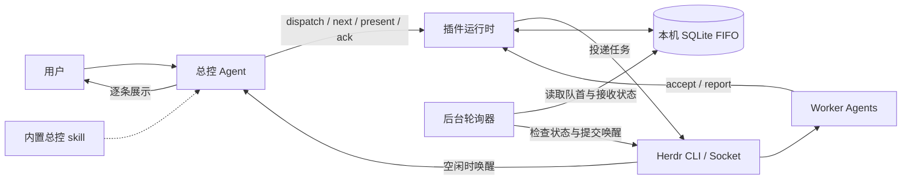
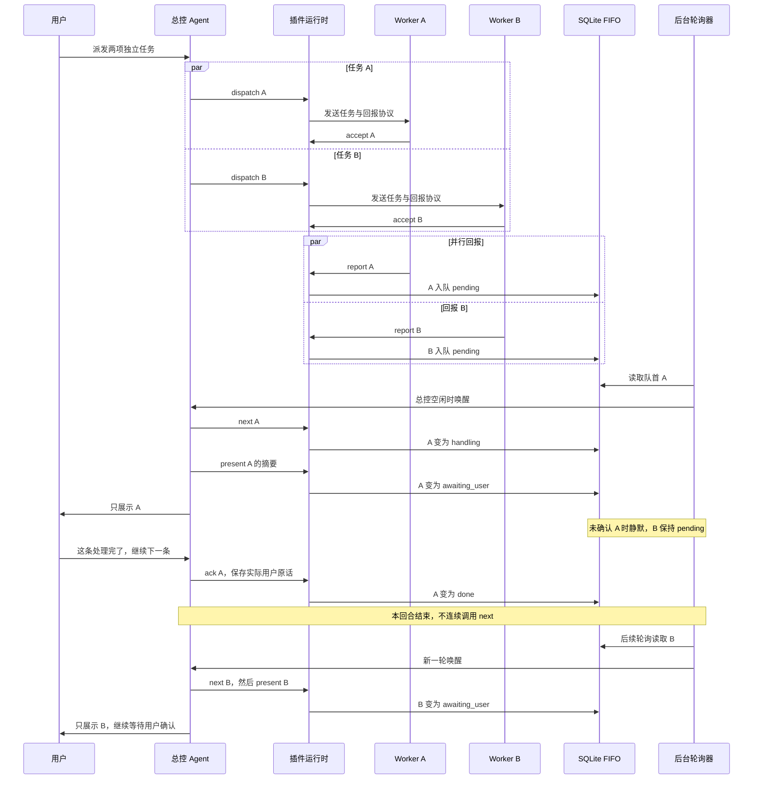

# Herdr Orchestrator

用于 Herdr 的任务编排插件：worker 并行执行，总控逐条展示回报。
多个结果同时到达时，只通知当前一条；用户明确处理完后，再主动通知下一条。

## 能力

- 统一安装内置总控 skill、派发协议、持久 FIFO、后台轮询和状态窗口。
- worker 明确接收后执行任务，完成或阻塞时回报实际结果与证据。
- 摘要、用户原话和确认时点持久保存，暂停和重启不解除等待用户状态。
- 同条后续派发接收齐全后可出队，不等待后续任务执行完成。
- 不同 Herdr 会话各自绑定总控并隔离队列，校验原生代理会话身份。

## 架构



总控负责理解任务、选择 worker、派发与汇总；worker 负责授权范围内的业务操作。
Mermaid 代码块按 [GitHub 官方图示指南](https://docs.github.com/en/get-started/writing-on-github/working-with-advanced-formatting/creating-diagrams)编写。

## 环境要求

| 项目 | 要求 |
| --- | --- |
| Herdr | 客户端与运行服务均为 0.9.3+，支持原生 `agent_session` |
| Python | 3.11+，运行时仅使用标准库 |
| Git | 可访问使用者选择的 GitHub 仓库与 ref |
| 系统 | Linux 或 macOS |
| Agent | 运行在 Herdr 管理的窗格内，已加载对应 integration |

尚未安装 Herdr 时，先按 [Herdr 官方 README](https://github.com/herdrdev/herdr/blob/master/README.md)准备环境。
下文的 `<owner>` 从当前插件仓库地址填写，其他尖括号内容也需替换；不要原样执行占位符。

## 快速开始

### 1. 安装插件

在目标 Herdr 会话内检查环境，核对输出；检查失败时先处理缺项，再安装固定版本：

```sh
test "${HERDR_ENV:-}" = 1
herdr --version
herdr status server
python3 --version
git --version
herdr plugin install <owner>/herdr-orchestrator-plugin --ref v0.2.2
herdr plugin list --plugin herdr-orchestrator --json
```

核对运行服务的版本与客户端兼容，JSON 中的版本为 0.2.2、`enabled` 为 true，来源与 ref 符合预期。
交互安装会展示信任预览；已授权的非交互安装可加 `--yes`。命令依据 [官方 CLI 文档](https://github.com/herdrdev/herdr/blob/master/docs/next/website/src/content/docs/cli-reference.mdx)。

Codex 用户先检查 integration，仅在缺失或过期时安装：

```sh
herdr integration status
# 仅在 codex integration 缺失或过期时执行
herdr integration install codex
```

已有 Codex 进程不会因为安装 integration 自动加载新设置。按需新启动 `codex --no-daemon`，
沿用用户已有审批和沙箱配置；发送第一条普通消息后，用 `herdr agent get <目标>` 核对 `agent_session.value`。
插件无需 pip 依赖，也无需将 bundled skill 复制进全局技能目录。

### 2. 绑定总控

用 `herdr agent list` 选择已运行的代理。手动方式：在 UI 选择该代理窗格，
执行 **Orchestrator: use this agent as coordinator** 插件动作。
`start` 根据 UI 当前 focus 绑定，不根据调用 shell 自动选择总控。

后台等待目标代理空闲后发送激活消息。该总控读取内置 skill，并执行消息提供的 `ready` 命令后完成激活；
动作成功只代表动作已启动。需要保持用户焦点的自动安装，应使用后文的显式 `bind --target`。

### 3. 发任务并逐条处理

直接向总控发送自然语言，无需手工管理内部 ID。例如：

```text
请把以下两项任务分别交给 worker：
在 /tmp/herdr-orchestrator-demo/hello.txt 写入 hello，在同目录 world.txt 写入 world。
只允许创建和读取该临时目录里的文件，分别回报实际内容。
优先复用合适的空闲 worker；每次只展示一条，等我处理完并确认，再主动通知下一条。
```

下面假设任务 A 先入队；实际顺序以 SQLite 成功写入的先后为准，本例没有后续派发。



说「这条处理完了」或「继续下一条」确认当前条。普通新任务、无关消息、仅追问或补充信息不自动确认。
同任务补充通常保留原 task ID 并交原 worker；用户指定其他代理或需要专用 worker 时按实际分工处理。
若同一消息明确确认当前条并安排后续，总控先登记后续派发，再保存确认；全部 accept 后才出队。
确认先于 accept 时，原话和时点先保存，不要求用户重复回复；已确认的接收异常只提醒检查当前条。

worker 的回报按任务复杂度说明结论、实际做了什么、重要具体结果或数据、关键依据与结果文件、
验证方式及重要输出和验证层级、未解决项或限制及下一步。完成回报不能只有「成功/已完成」或一个路径；
简单问候保留完整回复原文即可，无需凑字段或固定模板，也不需要推理过程或全部工具日志。
总控完整读取回报正文，保留判断和后续处理所需的具体内容，区分 worker 自报与总控实际核验；摘要不等于核验。
长报告先展示充分信息，再提供全文入口；present 保存这份展示正文，`summary-file` 的名称不要求压成简短摘要。

### 4. 查看状态、暂停与恢复

```sh
herdr plugin action invoke status --plugin herdr-orchestrator
herdr plugin action invoke stop --plugin herdr-orchestrator
herdr plugin log list --plugin herdr-orchestrator
```

状态窗口显示绑定、轮询、队列、接收和错误；关闭窗口只关闭视图。
stop 保留 worker 与历史，已派发 worker 仍可回报；恢复时对原总控执行 start。
代理身份变化时需先暂停，再显式 rebind。插件安装和 enabled 状态在同一用户的各 Herdr 会话间共享。

## 交给 Agent 安装

将下面提示复制给运行在 Herdr 内的 Agent，并填写仓库、版本和总控目标。
安装前由使用者决定是否信任插件；提示中的安装、绑定和 integration 修复属于本次请求授权。

```text
请安装并配置 Herdr Orchestrator：
仓库：<owner>/herdr-orchestrator-plugin（从当前仓库地址填写）
版本：v0.2.2
总控：<用户指定的现有代理名或窗格 ID>

1. 确认 HERDR_ENV=1；检查 Herdr 客户端、当前运行服务的版本和兼容性、Python 3.11+、Git。
   检查 integration status；缺失或过期时修复对应 integration，勿声称已有 Agent 自动加载。
   核对目标代理已发送第一条普通消息且有 agent_session.value，缺失就报告具体问题，不猜身份。
2. 若已安装，先列出受影响的启用会话并暂停其编排，等待旧轮询进程退出，做 SQLite 一致备份。
   GitHub 安装版按新 ref 重新 install，无需先 uninstall；本地 link 先按官方流程处理，不删除源码或状态。
3. 执行 herdr plugin install <owner>/herdr-orchestrator-plugin --ref v0.2.2 --yes。
   再读 herdr plugin list --plugin herdr-orchestrator --json，核对来源、ref、version、enabled，获取 plugin_root。
4. 确定实际 state-dir 与当前服务 socket：优先使用实际插件上下文的 HERDR_PLUGIN_STATE_DIR。
   若按官方对应版本的目录规则定位，必须核对运行服务的 HOME/XDG_STATE_HOME 和 release/debug 类型。
   config-dir 不等于 state-dir；不套用示例路径、不输出整个环境或凭据。无法确认就报告缺项，不猜路径。
5. 以实际 Python、plugin_root/orchestrator.py、--state-dir 和 --socket 组成完整 CLI，先读 --help。
   不改变用户焦点，用 CLI bind --target <用户指定目标>；身份冲突时先暂停，再按明确指定目标 rebind。
6. 总控读取 plugin_root/skills/herdr-orchestrator/SKILL.md，并由该总控执行 CLI ready。
   安装者不冒充总控执行 ready，不复制 skill 到全局目录；新 Codex 仅默认 --no-daemon，权限沿用用户授权。
7. 回读 CLI status 确认目标、enabled、activated、轮询与错误，核对插件日志，报告实际完成和缺项。
   不伪造用户 ack；业务闭环测试只在另获授权的临时范围内运行，并标明测试输入与真实用户确认的区别。
```

插件运行上下文与目录用途见 [官方插件文档](https://github.com/herdrdev/herdr/blob/master/docs/next/website/src/content/docs/plugins.mdx)。
路径定位核对对应版本的 [插件目录实现](https://github.com/herdrdev/herdr/blob/master/src/plugin_paths.rs)和 [状态目录实现](https://github.com/herdrdev/herdr/blob/master/src/config/io.rs)。

## 升级与数据

先在各启用会话暂停编排并确认旧轮询进程退出；暂停不会停止 worker 写回报。
使用 SQLite backup 生成一致备份；直接复制时需停止数据库写入并连同 WAL 保存，不能只复制活动数据库文件。
然后按新 ref 重新安装 GitHub 版，**无需先卸载**：

```sh
herdr plugin install <owner>/herdr-orchestrator-plugin --ref v0.2.2 --yes
herdr plugin list --plugin herdr-orchestrator --json
```

按官方重装流程更新 GitHub 安装版并保留配置和状态；重装不会自动重启插件运行进程。
从 plugin list 重新取得实际 plugin_root，核对原状态目录与版本；确认旧轮询已停，再用新版入口恢复各会话绑定。
参见 [官方 CLI 的重装规则](https://github.com/herdrdev/herdr/blob/master/docs/next/website/src/content/docs/cli-reference.mdx)。

从 v0.1.0 升级时，插件事务迁移 schema v1 至 v2，仅新增展示时间、确认原文、文件位置和确认时间。
原任务、回报、摘要、序号和接收记录保留；pending/handling 不自动 done，旧 done 不伪造用户确认。
v0.2.2 沿用 schema v2；等待用户状态在暂停和重开后保持，显式更换总控仍需激活 skill。
旧 v0.1.0 不能直接打开 schema v2；回退须暂停后恢复升级前的一致备份。

## 故障排查

| 现象 | 检查和处理 |
| --- | --- |
| 版本或环境不满足 | 对照客户端、运行服务、Python 和 Git；缺 Herdr 环境时回到受管窗格。 |
| 缺少原生会话身份 | 检查 integration；按需新启动 Agent，第一条消息后核对 agent_session，不造 ID。 |
| 已启用但没激活 | 查绑定、activated、动作日志与轮询错误；总控 working/blocked/unknown 时不投递。 |
| 等待用户且下一条已到达 | 属于正常 FIFO；确认当前条后才会通知下一条，不重复催用户。 |
| 已确认但仍在等待接收 | 查后续派发 accept；blocked/missing/replaced 只提醒当前接收问题，不重发任务。 |
| 派发超时或投递不明 | 查已保存的派发及 worker 状态；超时不代表未执行，不盲目重派。 |
| 总控被替换 | 暂停后显式 bind --target 并加 --rebind，保留历史与等待状态。 |
| 本地 link 与 GitHub 安装冲突 | 先暂停，再 unlink 本地插件后安装；源码与数据不主动删除。 |

卸载前暂停各会话并备份需要的数据。`plugin uninstall herdr-orchestrator` 不关闭 worker；数据生命周期由使用者管理。

## 协议与边界

- 运行数据持久化在本机，插件不将其写入 GitHub；Agent 与模型按各自配置处理上下文，不承诺上下文永远留在本机。不要把运行数据放进安装源码目录。
- FIFO 以 SQLite 入队顺序为准，只有当前队首可展示或首次确认。未确认的 awaiting_user 保持静默。
- ack 是总控记录实际用户消息的入口；程序校验调用会话、event 与状态，不能证明真人原话或自然语言确认意图。
- 同 event 同原文重试幂等，保留确认时点；冲突原文拒绝，旧确认不会确认新的队首。确认后封闭该条的后续派发。
- 出队要求持久用户确认与所有未撤销后续派发 accept；代理 idle/done、超时和 accept 均不是用户确认或业务完成。
- 每 5 秒是轮询周期，不是最终通知时延承诺；总控忙、被审批阻塞或宿主离线时通知推迟。未展示通知最多每分钟重试。
- 聊天展示与 present、终端派发与 SQLite 不能共享事务，不保证 exactly-once；极端中断需核对摘要、聊天与接收记录。
- 直接原生 agent prompt --wait 的终端答复不进入队列；所有需逐条回报的任务应走 dispatch/accept/report。
- 插件与 skill 不扩大权限，不代答未授权审批，也不是代理沙箱；暂停编排不会终止 worker。

## 开发与验证

```sh
python3 orchestrator.py check-runtime
python3 -m unittest discover -s tests -v
herdr plugin link "$PWD"
```

现有 32 项 unittest 覆盖 SQLite、并发生产者、CLI 子进程、FIFO、确认/接收门槛、迁移、重入和身份隔离；传输使用 FakeHerdr 或模拟 CLI。
仓库记录的 Linux 集成验证使用 Herdr 0.9.3、Codex 0.162.1，一个真实总控和两个真实 worker：
两条回报经插件协议入队，先展示第一条，等待超过两分钟不展示第二条；确认后轮询另起一轮展示第二条。
该验证的模型与终端投递是真实的，处理完成消息是隔离测试输入，不能充当正式会话的实际用户确认。
未验证 macOS、真实审批 UI、整个服务重启后的模型恢复和正式用户亲自完成两条回报；本版回报提示调整不扩大这些结论。

<details>
<summary>高级 CLI 协议（供总控与 worker 使用）</summary>

`CLI` 是激活消息里的完整入口占位词，含 Python、绝对程序路径、state-dir 和 socket，不是新增系统命令。

```text
CLI ready
CLI dispatch --target WORKER --task-file TASK.json
CLI wait-accepted --dispatch DISPATCH_ID --timeout 10
CLI next
CLI present --event EVENT --summary-file /tmp/herdr-orchestrator-demo/summary.txt
CLI dispatch --target WORKER --task-file TASK.json --task-id TASK_ID --parent-event EVENT
CLI ack --event EVENT --reply-file /tmp/herdr-orchestrator-demo/user-reply.txt
CLI accept --dispatch DISPATCH_ID
CLI report --dispatch DISPATCH_ID --message-id MESSAGE_ID --status completed --result-file /tmp/herdr-orchestrator-demo/result.txt
CLI status
CLI stop
CLI bind --target COORDINATOR --rebind
CLI abandon --dispatch DISPATCH_ID --reason 已检查的撤销原因
```

任务 JSON 必须含非空字符串 goal、scope、authorization、acceptance_criteria。worker 的具体命令由派发消息提供，必须先 accept 再执行，结果状态为 completed 或 blocked。
结果、摘要与确认文件必须是绝对路径 UTF-8 文件，正文持久保存。next 只将 pending 改为 handling；present 保存摘要并进入 awaiting_user，相同摘要重试幂等。
只有最新实际用户消息明确确认当前条才 ack；普通追问不自动出队。确认先于 accept 时保留原话，接收齐全后自动出队，不要求重说。
确认后结束本回合，下一条由轮询唤醒，不批量 next。finish 已移除；abandon 撤销回报资格，不停止 worker。

</details>

## 许可证

[MIT License](LICENSE)，Copyright (c) 2026 Herdr Orchestrator contributors。
